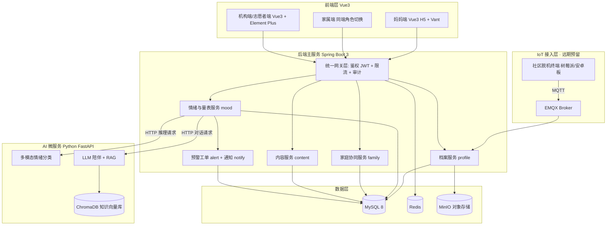

# 03 · 技术架构（Vue3 + Spring Boot 版）

## 1. 技术栈总览

| 层 | 技术 | 理由 |
|---|---|---|
| 用户端前端 | **Vue3 + Vite + TS + Pinia + Vant（移动 H5，已定案）** | 开发最快、技术纯粹、扫码/链接直达；小程序列为二期可选 |
| 机构端前端 | **Vue3 + Vite + TS + Element Plus + ECharts** | 后台看板/表格生态成熟 |
| 后端主服务 | **Java 17 + Spring Boot 3.x + Spring Security(JWT) + MyBatis-Plus** | 工程规范、评委熟悉、团队技术栈匹配 |
| 数据 | MySQL 8 + Redis + MinIO（自托管对象存储） | 比赛演示不依赖云厂商，`docker compose` 一键起 |
| AI 微服务 | Python 3.10 + FastAPI + transformers/sklearn + LLM API + ChromaDB(向量) | 算法生态在 Python；与 Java 主服务通过 HTTP 通信 |
| 消息推送 | 站内信 + SSE/WebSocket 在线推送（可选短信），抽象统一接口 | H5 无小程序订阅消息是已知取舍；接口抽象为二期换端留路 |
| 部署 | Docker Compose + Nginx 反向代理 | 单机跑全套，评委现场可复现部署 |
| 嵌入式脱机终端 | **远期规划，本期只在架构上预留**（见第 7 节） | 不影响一期交付 |

> **微服务说明**：整体采用"**模块化单体（Spring Boot 多 module）+ 1 个 Python AI 微服务**"。
> 不要上 Spring Cloud 全家桶——对比赛项目是过度设计，评委反而会问"你有几个服务要治理？"
> Java 管业务，Python 管模型，职责清晰，这个分工本身就是答辩亮点。

### 1.1 用户端形态：已定案 —— 纯 Vue3 H5

**结论：方案 B（Vite + Vant 移动 H5）**，2026-11-02 与团队讨论定案。

带来的影响与对策：

- **推送**：无小程序订阅消息，走站内信 + SSE/WebSocket 在线推送（可选短信兜底）；产品文案**不承诺"实时提醒"**
- **传播**：二维码 / 短链直达，医院社区地推不受影响
- **二期换端**：若后续需要小程序，用 uni-app 重写用户端（Vue3 语法迁移成本低），NotificationService 抽象已为此留路
- 机构端不受影响（本来就是 Web 后台）

---

## 2. 总体架构图



**降级设计（答辩必讲）**：`mood 服务 → AI 微服务` 的调用带超时与熔断；
**AI 服务不可用时自动降级为纯规则模式（量表 + 行为规则），核心服务不中断**。
"AI 挂了系统还能跑"——这句话在评委面前价值极高。

---

## 3. 后端设计（Spring Boot）

### 3.1 模块划分（Maven 多 module）

```
yuji-server
├── yuji-common        // 统一返回体、异常、工具、审计基类
├── yuji-auth          // JWT 签发/刷新、RBAC、数据权限
├── yuji-profile       // 档案、孕周计算、产检计划
├── yuji-mood          // 情绪打卡、量表、风险分级、调用 AI 服务
├── yuji-family        // 家庭关系、任务包、权限授权
├── yuji-content       // 内容库、来源标注、反馈
├── yuji-org           // 机构、志愿者、工单流转
└── yuji-notify        // 推送抽象(SSE/WS/小程序订阅消息)、预警通知
```

### 3.2 关键技术点（每个都能在答辩里讲 1 分钟）

| 点 | 方案 | 讲法 |
|---|---|---|
| 鉴权 | Spring Security + JWT + RBAC | 家属端**字段级数据权限**：默认只见任务与状态摘要，量表得分需逐项授权 |
| 量表触发 | Spring Scheduler 定时扫描孕周/产后周 | "42 天产后筛查自动触发"是临床规范落地 |
| 风险分级 | 策略模式 + 可配置规则表（规则入库、可审计、可人工覆盖） | **可解释分级**，评委问"误判怎么办"的答案 |
| 推送 | NotificationService 抽象多通道 | 双端形态的工程解耦能力 |
| 敏感数据 | AES 字段加密 + jasypt 配置加密 + 日志脱敏 | 健康数据合规的技术兑现 |
| 幂等与限流 | Redis 令牌桶 + 接口幂等键 | 工程成熟度 |
| 软删与审计 | MyBatis-Plus 逻辑删除 + 操作审计表 | 合规可追溯 |

---

## 4. AI 微服务（Python FastAPI）

### 4.1 与 Java 的分工边界

| 职责 | 归属 |
|---|---|
| 业务流程、权限、审计、规则分级、工单流转 | **Java** |
| 情绪分类模型推理、LLM 对话、RAG 检索 | **Python** |

接口契约（示例）：

```
POST /api/v1/emotion/predict
  请求: { text, audio_features?, scale_scores, behavior_features }
  响应: { risk_prob, level, contributions:[{feature, weight}] }   // 可解释输出
```

> 响应里的 `contributions`（特征贡献）来自 SHAP/特征权重，
> 是**可解释性**的直接实现——前端据此渲染"为什么提示你关注"。

### 4.2 三个 AI 能力（按风险从低到高）

| 能力 | 做什么 | 风险 | 落地方式 |
|---|---|---|---|
| 内容生成 | 权威指南改写为"今日 3 件事" | 低 | RAG + 固定模板 + 人工抽检 |
| 情绪识别 | 打卡文本/语音 → 情绪标签与风险概率 | 中 | 文本模型 + 声学特征 + 规则兜底 |
| 陪伴对话 | 非评判式倾听与引导 | 高 | LLM + 强系统提示 + 敏感词拦截 + 转人工 |

### 4.3 RAG 语料（必须权威、必须标源）
《孕前和孕期保健指南》、妊娠期高血压/高血糖诊治指南、《产后访视工作规范》、国家基本公共卫生服务规范等。
**回答必须附"依据来源 + 版本号"**——专业性 + 合规双重得分。

### 4.4 安全护栏（写进 PPT 会加分）
1. **输入侧**：敏感意图识别（自伤/自杀/用药剂量）→ 中断生成，转固定安全话术 + 热线 + 一键求助
2. **生成侧**：系统提示硬约束——不诊断、不开药、不评价胎儿性别、不否定就医决定
3. **输出侧**：风险类回答强制展示就医入口 + "不能替代医生诊断"声明
4. **兜底**：黄/红事件一律进人工队列，**AI 不闭环**

### 4.5 风险分级规则（规则优先，模型辅助）

```
绿：连续 3 天 mood_score <= 2 且无高危关键词 → 推自助内容
黄：EPDS >= 10 或连续 5 天低落或检出"失眠/无助"标签 → 生成工单，48h 内人工联系
红：EPDS 第 10 题（自伤想法）> 0 或命中自伤/自杀关键词 → 立即弹窗 + 热线 + 通知紧急联系人（需事前授权）
```

> **AI 只做初筛与建议，黄红档一律人工复核**——这是被问"AI 误判怎么办"时的标准答案。

---

## 5. 核心数据模型

```
user              用户（id, openid, role, phone_hash, created_at）
profile           档案（user_id, stage, lmp_date, edd, due_week, history_flags）
health_record     健康记录（user_id, type, value_json, recorded_at）
checkup           产检项（user_id, item, due_week, status, report_url）
mood_log          情绪打卡（user_id, score, text, voice_url, tags, created_at）
scale_result      量表结果（user_id, scale, score, level, items_json, created_at）
risk_event        风险事件（user_id, level, source, status, handler_id, closed_at）
family_link       家庭关系（mom_id, member_id, relation, permissions(JSON)）
task / task_template  协同任务与模板
content           内容（title, body_md, source, version, tags, stage_range）
referral / org    转介与机构
device            IoT 设备（远期：device_sn, org_id, last_sync_at, status）
```

**设计要点**
- `health_record` 用 `type + value_json` 宽表结构，加指标不改表
- `risk_event` 独立表 + 状态机（待处理→处理中→已关闭），是人工工作台，也是社会效益指标来源
- 所有含健康信息的表带 `deleted_at`（软删）与 `consent_version`（同意版本号）
- `family_link.permissions` 用 JSON 存逐项授权，支撑字段级数据权限

---

## 6. 安全与合规技术措施

- 全站 HTTPS；手机号/姓名 AES 加密存储；日志统一脱敏
- 健康数据属敏感个人信息：单独同意、可撤回、可导出、可删除（提供"一键注销并删除全部数据"）
- 权限最小化：家属端默认不可见情绪记录与量表得分
- 操作审计日志：谁在何时查看了谁的数据
- 数据留存期限 + 到期自动清理定时任务
- 生成式内容显著标识"AI 生成/辅助"；上线前评估生成式 AI 备案义务

---

## 7. 嵌入式脱机终端（远期，本期只预留）

**场景**：县域/社区"她驿站"里的离线自助终端——触屏自助做量表、打印健康提示、离线缓存数据，解决"老人不会用智能手机 + 网络差"的数字鸿沟问题。

| 项 | 规划 |
|---|---|
| 硬件形态 | 安卓平板/树莓派 + 触屏 + 小票打印机（低成本方案） |
| 软件 | 本地跑 Vue3 H5（同一套前端！）+ 本地 SQLite 缓存 |
| 通信 | MQTT（EMQX Broker）接入后端，联网后批量同步离线数据 |
| 本期动作 | **只在架构图预留 IoT 接入层 + `device` 表 + 同步协议草案** |

**对三个比赛的价值**：
- 4C：架构完整度与"物联网融合"叙事（如果未来报物联网类还能复用）
- 挑战杯：县域妇幼健康服务可及性的技术路线
- 互联网+：公益下沉故事 + 硬件成本可测算的商业模式扩展

> **重要**：答辩时说"架构已预留 IoT 接入层与设备同步协议，一期聚焦软件平台"——
> 既展示了前瞻性，又守住了交付边界，比硬做一个半成品硬件强得多。

---

## 8. 技术难点与应对

| 难点 | 应对 |
|---|---|
| 冷启动无数据 | 先规则 + 模板，AI 只做体验增强；公开情感数据集打底 |
| 量表专业性 | 只用公开发表的中文版标准量表，注明版本与计分规则，不改编 |
| 语音情绪识别 | 一期可先不做，列为二期（4C 若报 AI 类则建议做，见 `07` 文档 5.1） |
| 双端数据一致性 | 妈妈端为唯一写入源；家属端只读 + 任务状态回写 |
| AI 服务不稳定 | 超时熔断 + 规则降级（见第 2 节） |
| Demo 现场翻车 | docker compose 一键部署 + 录屏兜底 + 演示专用账号（绿/黄/红各一） |

---

## 9. 开发排期

详细的一期 8 周排期、功能冻结清单与 API 草案见 **[08-一期开发计划.md](08-一期开发计划.md)**
（已定案：Vue3 H5 前端 + Java/Spring Boot 后端，模块顺序 **B 健康档案 → C 家属协同 → D 社区公益 → A 情绪分级**，机构端进一期）。

节奏概览：

| 周 | 内容 |
|---|---|
| W1 | 脚手架 + `docker compose` + 登录 + 建档 |
| W2–W3 | 孕周 / 产检日历 / 指标 / 报告 / 趋势图（模块 B） |
| W4–W5 | 家属协同 + 机构端雏形（模块 C） |
| W6 | 树洞 / 驿站 / 公益申请（模块 D，轻量） |
| W7–W8 | 情绪打卡 + EPDS + 规则分级 + 工单 + 看板（模块 A + 机构端） |

> 交付标准：`git clone` → `docker compose up` → 打开链接即可用。
> **评委现场看你一键部署成功，本身就是强说服力。**
